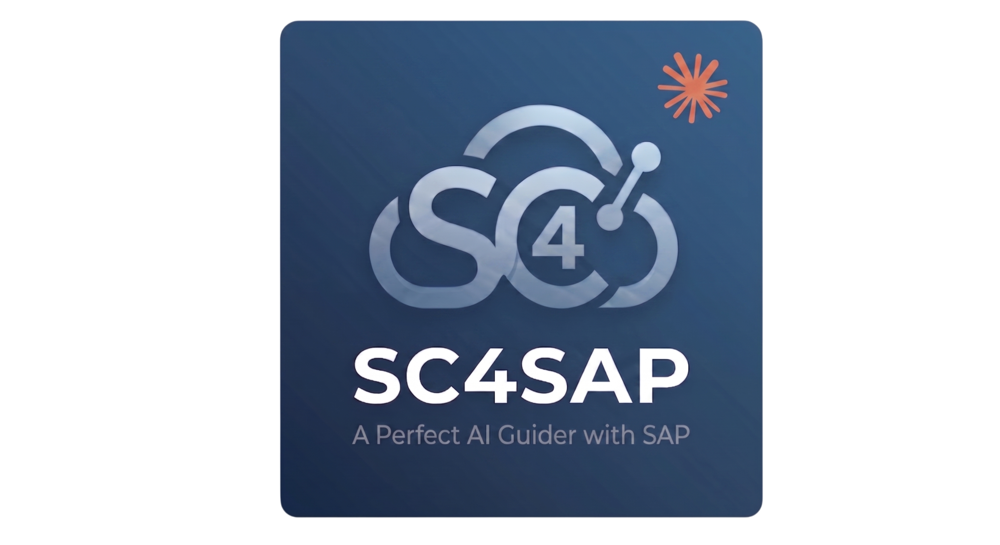

<p align="center">
  
</p>

<p align="center">
  <a href="README.md">English</a> | <a href="README.ko.md">한국어</a> | <a href="README.ja.md">日本語</a> | Deutsch
</p>

# SuperClaude for SAP (sc4sap)

> Claude-Code-Plugin für die SAP-ABAP-Entwicklung — SAP ECC / S/4HANA On-Premise / S/4HANA Cloud (Public & Private)

<p align="center">
  <a href="https://sc4sap.dev"></a>
</p>

<h1 align="center"><a href="https://sc4sap.dev">🌐 sc4sap.dev</a></h1>

<p align="center"><b>Offizielle Website — direkt im Browser ausprobieren</b></p>

[](https://sc4sap.dev)
[](https://www.npmjs.com/package/@babamba2/abap-mcp-adt-powerup)
[](https://github.com/babamba2/superclaude-for-sap/releases)
[](https://github.com/babamba2/superclaude-for-sap)
[](LICENSE)

## Was ist sc4sap?

**Claude Code, verbunden mit Ihrem SAP-System, übernimmt ABAP-Entwicklung, Dokumentation und Betriebsaufgaben für Sie.**

- Unterstützt werden SAP ECC, S/4HANA On-Premise und S/4HANA Cloud (Public / Private).
- Es hilft Entwicklern, Fachberatern, PM / PMO und dem Betrieb (SM / AMS / Basis).
- Sie bitten einfach in normalen Sätzen darum. Version 1.0.0.

## Was Sie damit tun können (nach Rolle)

### Entwickler

| Was Sie sagen / eingeben | Was Sie bekommen |
|------|------|
| `/sc4sap:create-program` | Report / ALV / CRUD / Batch mit Main + Include. Entwurf, Code und Prüfung in einem Lauf. |
| `/sc4sap:create-object` | Ein Objekt (Klasse, Tabelle, Funktionsbaustein …). Transport und Paket werden abgefragt, dann wird aktiviert. |
| `/sc4sap:program-test` | Test eines vorhandenen Programms auf DEV. Erwartete Werte stehen vorher fest. Echte Daten werden maskiert. |
| `/sc4sap:analyze-code` | Code-Review zu Clean ABAP, Performance und Sicherheit, nach Schweregrad sortiert. |
| `/sc4sap:program-to-spec` | Fach- / Technische Spezifikation zu einem Programm (Markdown, HTML, Excel). |
| `/sc4sap:program-to-manual` | Benutzerhandbuch zu einem Programm als HTML. |
| `/sc4sap:compare-programs` | HTML-Bericht, der 2 bis 5 Programme fachlich vergleicht. |
| `/sc4sap:interface-mapping-spec` | Mapping-Spezifikation für eine Schnittstelle als HTML. |
| `/sc4sap:smartform-preview` | Das erwartete Druckbild eines SmartForms als JPG. |
| `/sc4sap:smartform-from-pdf` | Ein SmartForm aus einer PDF-Vorlage. Das Druckbild wird mit dem Original verglichen und bewertet. |
| `/sc4sap:smartform-to-adobe`, `adobe-preview` | Umstellung SmartForm auf Adobe-Formular planen. Druckbild eines Adobe-Formulars zeichnen. `adobe-from-pdf` ist in Vorbereitung. |

### Fachberater

| Was Sie sagen / eingeben | Was Sie bekommen |
|------|------|
| `/sc4sap:ask-consultant` | Antwort eines Modulberaters, passend zu Ihrer SAP-Umgebung. |
| `/sc4sap:assist` | Belege abfragen und ändern, z. B. offene Bestellungen, Wareneingang, Fakturen. Vor jeder Änderung fragt es nach. |
| `/sc4sap:config-to-document` | Die Konfiguration eines Moduls als HTML, entlang des IMG-Baums. |
| `/sc4sap:module-to-process` | Die Geschäftsprozesse eines Moduls als eine HTML-Seite. |
| `/sc4sap:uat-scenarios` | UAT- und Integrationstest-Szenarien, die Sie weiter bearbeiten können. |
| `/sc4sap:cbo-relation-map` | Eine Karte, wie Ihre Z- / Y-Objekte zusammenhängen. |
| `/sc4sap:stock-cbo` | Bestandsaufnahme eines Z-Pakets. Spätere Entwicklungen nutzen vorhandene Objekte zuerst. |

### PM / PMO

| Was Sie sagen / eingeben | Was Sie bekommen |
|------|------|
| `/sc4sap:project-dashboard` | HTML-Dashboard je Projekt und eine Portfolio-Seite über alle Projekte. |
| `/sc4sap:role-matrix` | Rollen- und Berechtigungskonzept als bearbeitbare HTML-Arbeitsmappe. |

### Betrieb (SM / AMS / Basis)

| Was Sie sagen / eingeben | Was Sie bekommen |
|------|------|
| `/sc4sap:analyze-symptom` | Schrittweise Ursachensuche bei Fehlern. Nur lesend, nichts wird geändert. |
| `/sc4sap:ops-health-check` | Morgenbericht zu Dumps, abgebrochenen Jobs, Verbuchungsfehlern und mehr. |
| `/sc4sap:transport-readiness` | Prüfung und Urteil, bevor Transportaufträge nach QA / PRD gehen. |
| `/sc4sap:sap-doctor` | Prüft Plugin, MCP-Server und SAP-Verbindung. |

## Erste Schritte (5 Schritte)

1. Voraussetzungen: Claude Code, Node.js und ein SAP-Benutzer mit ADT-Zugriff.
2. Plugin installieren. Geben Sie in Claude Code ein:
   ```
   /plugin marketplace add https://github.com/babamba2/superclaude-for-sap.git
   /plugin install sc4sap
   ```
3. Führen Sie `/sc4sap:setup` aus. Es legt die SAP-Verbindung an, installiert den MCP-Server und testet die Verbindung.
4. Probieren Sie eine Anfrage aus. Zum Beispiel: „Erkläre mir das Programm ZMMR00040."
5. Ergebnisse landen in Ordnern Ihres Projekts, z. B. `projects/<CODE>/` oder `smartforms/<FORM>/`.

Die ganze Anleitung finden Sie hier: [Erste Schritte](docs/GETTING-STARTED.md) und [Installation & Einrichtung](docs/INSTALLATION.de.md).

## Einfach sprechen

Sie müssen keine Slash-Befehle kennen. Normale Anfragen werden an den passenden Skill weitergeleitet (Regeln in `common/skill-router.md`).

- „Zeig mir den Status der Bestellung 4500001234."
- „Prüfe das Programm ZMMR00040."
- „Erstelle aus dieser PDF ein SmartForm."

## Sicher gebaut

- QA- und PRD-Profile sind schreibgeschützt. Ein Hook und der MCP-Server blockieren Schreibzugriffe.
- Datenabzug wird je Tabelle abgefragt. Sperrlisten (Blocklist) schützen sensible Tabellen.
- Passwörter liegen im Anmeldespeicher des Betriebssystems (Windows Credential Manager / macOS Keychain / libsecret).
- Bearbeitet werden nur eigene Objekte (Z / Y). SAP-Standardobjekte bleiben unberührt.
- Jede Änderung läuft über einen Transportauftrag. Sie wird aktiviert und syntaktisch geprüft.

## Kostenmodi

- `standard`: Qualität zuerst.
- `eco`: günstigere Modelle, gleiches Ergebnis.
- Dauerhaft stellen Sie den Modus mit `/sc4sap:sap-option` ein. Für einen einzelnen Lauf nutzen Sie `/sc4sap:eco <Skill>`.

## So funktioniert es (kurz)

- Der [MCP ABAP ADT Server](https://github.com/babamba2/abap-mcp-adt-powerup) (150+ Tools) verbindet Claude mit SAP.
- 27 spezialisierte Agenten arbeiten zusammen: Berater je Modul, Entwickler, Reviewer, Prüfer und weitere.
- Sie können mehrere SAP-Profile (DEV / QA / PRD) anlegen und umschalten.
- Branchenwissen (14 Branchen) und Länderwissen (15 Länder + EU) sind eingebaut.

## Dokumentation

- 🚀 **[Erste Schritte (Englisch / Koreanisch) →](docs/GETTING-STARTED.md)** — von der Windows-Einrichtung bis zum Funktionstest
- 📦 **[Installation & Einrichtung →](docs/INSTALLATION.de.md)** — Voraussetzungen, Optionen, Blocklist-Konfiguration
- 🎯 **[Funktionen im Detail →](docs/FEATURES.de.md)** — Agenten, Skills, MCP-Tools, Hooks, Richtlinie zur Datenextraktion
- 📜 **[Änderungsprotokoll →](docs/CHANGELOG.de.md)** — Versionsverlauf und Breaking Changes

## Unleashed

<p align="center">
  <a href="sc4sap_unleashed.png">
    
  </a>
</p>

## Autor

- **paek seunghyun** &nbsp; [](https://www.linkedin.com/in/seunghyun-paek-5b83b7183/)

## Mitwirkende

- **김시훈 (Kim Sihun)** &nbsp; [](https://www.linkedin.com/in/sihun-kim-27737132b/)
- **Jan Bloudicek** &nbsp; [](https://github.com/JanBloudicek) — Modell-Aliasse für die Agenten ([#47](https://github.com/babamba2/superclaude-for-sap/pull/47))

## Danksagung

Dieses Projekt wurde von [**oh-my-claudecode**](https://github.com/huryechan/oh-my-claudecode) von **허예찬 (Hur Ye-chan)** inspiriert. Die Multi-Agent-Orchestrierungsmuster, Socratic Deep-Interview Gating, persistente Loop-Konzepte und die gesamte Plugin-Philosophie lassen sich auf diese Arbeit zurückführen.

[**mcp-abap-adt**](https://github.com/fr0ster/mcp-abap-adt) von **fr0ster** hat wesentlich zum Aufbau unseres angepassten MCP-Servers (`abap-mcp-adt-powerup`) beigetragen. Die bahnbrechende ADT-über-MCP-Arbeit — Request-Shaping, Endpoint-Abdeckung, Objekt-I/O — war die konzeptionelle Grundlage, auf die wir uns beim Entwurf und der Erweiterung unseres eigenen Servers gestützt haben.

## Lizenz

[MIT](LICENSE)
