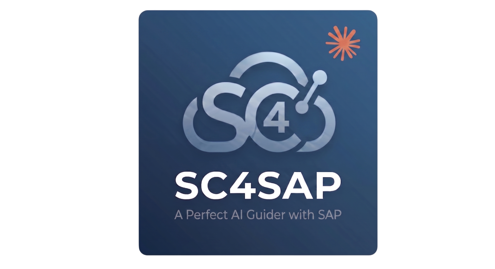

<h2 align="center"><a href="https://sc4sap.dev/install-guide.html">📘 はじめての方はインストールガイドから →</a></h2>

<p align="center">Windows 向けの手順書です。所要時間は 30〜40 分です（韓国語）。</p>

<p align="center">
  
</p>

<p align="center">
  <a href="README.md">English</a> | <a href="README.ko.md">한국어</a> | 日本語 | <a href="README.de.md">Deutsch</a>
</p>

# SuperClaude for SAP (sc4sap)

> SAP ABAP 開発向け Claude Code プラグイン — SAP ECC / S/4HANA On-Premise 対応

<p align="center">
  <a href="https://sc4sap.dev"></a>
</p>

<h1 align="center"><a href="https://sc4sap.dev">🌐 sc4sap.dev</a></h1>

<h3 align="center">SAP 運用を、ブラウザで。（ベータ版）</h3>

<p align="center">インストール不要。ダンプ分析、運用レポート、プロジェクトダッシュボード、権限設計まで、スマートフォンでも使えます。</p>

[](https://sc4sap.dev)
[](https://www.npmjs.com/package/@babamba2/abap-mcp-adt-powerup)
[](https://github.com/babamba2/superclaude-for-sap/releases)
[](https://github.com/babamba2/superclaude-for-sap)
[](LICENSE)

## sc4sap とは

**SAP システムにつないだ Claude Code が、ABAP 開発・ドキュメント作成・運用の仕事を代わりに進めます。**

- SAP ECC と S/4HANA On-Premise に対応しています。
- 開発者、機能コンサルタント、PM / PMO、運用担当(SM / AMS / Basis)の仕事を支えます。
- 日本語や英語で普通に頼むだけで使えます。バージョンは 1.0.0 です。

## できること(役割別)

### 開発者

| 頼むこと | 得られるもの |
|------|------|
| `/sc4sap:create-program` | Report / ALV / CRUD / バッチを Main + Include で作成。設計、実装、確認までまとめて実行します。 |
| `/sc4sap:create-object` | クラス、テーブル、関数モジュールなどを 1 つ作成。移送とパッケージを確認し、有効化します。 |
| `/sc4sap:program-test` | 既存プログラムを DEV でテスト。期待結果を先に決め、実データを読み、個人情報をマスクした値で実行します。 |
| `/sc4sap:analyze-code` | Clean ABAP、性能、セキュリティのレビュー結果を重大度順に出します。 |
| `/sc4sap:program-to-spec` | プログラムから機能 / 技術仕様書(Markdown、HTML、Excel)を作成します。 |
| `/sc4sap:program-to-manual` | 1 本のプログラムのエンドユーザーマニュアル(HTML)を作成します。 |
| `/sc4sap:compare-programs` | 2〜5 本のプログラムを業務の観点で比べる HTML レポートを作成します。 |
| `/sc4sap:interface-mapping-spec` | インターフェースのマッピング仕様書(HTML)を作成します。 |
| `/sc4sap:smartform-preview` | SmartForm の印刷イメージを JPG で描きます。 |
| `/sc4sap:smartform-from-pdf` | 帳票の PDF から SmartForm を作成し、印刷結果を元と比べてスコアを出します。 |
| `/sc4sap:smartform-to-adobe`、`adobe-preview` | SmartForm から Adobe フォームへの変換を計画し、Adobe フォームの印刷イメージを描きます。`smartform-to-adobe` はベータ版で、品質はまだ低いです。`adobe-from-pdf` は準備中です。 |

### 機能コンサルタント

| 頼むこと | 得られるもの |
|------|------|
| `/sc4sap:ask-consultant` | モジュールコンサルタントが、お使いの SAP 環境に合わせて質問に答えます。 |
| `/sc4sap:assist` | 未決の PO、入庫、請求などの伝票を照会・変更します。変更の前に必ず確認します。 |
| `/sc4sap:config-to-document` | モジュールの設定内容を IMG ツリーに沿った HTML にまとめます。 |
| `/sc4sap:module-to-process` | モジュールの業務プロセスを 1 つの HTML にまとめます。 |
| `/sc4sap:uat-scenarios` | UAT / 結合テストのシナリオを、編集し続けられる形で作成します。 |
| `/sc4sap:cbo-relation-map` | 自社開発 (Z / Y) オブジェクトのつながりを図にします。 |
| `/sc4sap:stock-cbo` | 自社開発パッケージを棚卸しします。以後の開発で既存資産を優先して使います。 |

### PM / PMO

| 頼むこと | 得られるもの |
|------|------|
| `/sc4sap:project-dashboard` | プロジェクトごとの HTML ダッシュボードと、全体のポートフォリオ。 |
| `/sc4sap:role-matrix` | ロールと権限の設計書(編集できる HTML ワークブック)。 |

### 運用(SM / AMS / Basis)

| 頼むこと | 得られるもの |
|------|------|
| `/sc4sap:analyze-symptom` | エラーの原因を順番に調べます。参照のみで、何も変更しません。 |
| `/sc4sap:ops-health-check` | ダンプ、中断ジョブ、更新エラーなどの朝の点検レポート。 |
| `/sc4sap:transport-readiness` | 移送依頼を QA / 本番へ送る前の確認と判定。 |
| `/sc4sap:sap-doctor` | プラグイン、MCP サーバー、SAP 接続の健全性を診断します。 |

## はじめかた(5 ステップ)

1. 準備するもの: Claude Code、Node.js、ADT へのアクセス権がある SAP ユーザー。社内の SAP サーバーに初めて接続する場合は、Basis 担当者が Web ポート、ICF、権限を先に準備します(ガイド B1〜B4)。
2. プラグインを入れます。Claude Code で次を実行します。
   ```
   /plugin marketplace add https://github.com/babamba2/superclaude-for-sap.git
   /plugin install sc4sap
   ```
3. `/sc4sap:setup` を実行します。SAP 接続の登録、MCP サーバーのインストール、接続テストまで進みます。
4. 試しに 1 つ頼みます。例: 「ZMMR00040 の内容を説明して」
5. 成果物はプロジェクトのフォルダに保存されます(例: `projects/<CODE>/`、`smartforms/<FORM>/`)。

詳しい手順は [インストールガイド](https://sc4sap.dev/install-guide.html)(韓国語、Basis の準備を含む)、[はじめての方へ](docs/GETTING-STARTED.ja.md) と [インストール & セットアップ](docs/INSTALLATION.ja.md) をご覧ください。

## 話しかけるだけで使えます

スラッシュコマンドを覚える必要はありません。普通に頼めば、ふさわしいスキルに振り分けられます(ルールは `common/skill-router.md`)。

- 「購買発注 4500001234 の状況を見せて」
- 「ZMMR00040 のレビューをして」
- 「この PDF の帳票から SmartForm を作って」

## 安全のしくみ

- QA / PRD プロファイルは読み取り専用です。フックと MCP サーバーの 2 か所で書き込みを止めます。
- データの取り出しは、テーブルごとに確認します。読ませないテーブルはブロックリストで指定できます。
- パスワードは OS の資格情報ストア(Windows Credential Manager / macOS Keychain / libsecret)に保管します。
- 対象は自社開発 (Z / Y) オブジェクトだけです。SAP 標準オブジェクトには触れません。
- すべての変更は移送依頼に載せ、有効化と構文チェックを行います。

## コストモード

- `standard`: 品質を優先します。
- `eco`: より安価なモデルを使います。成果物は同じです。
- `/sc4sap:sap-option` で常時の設定を変えます。1 回だけ使うときは `/sc4sap:eco <スキル名>` と入力します。

## 内部のしくみ(かんたんに)

- [MCP ABAP ADT サーバー](https://github.com/babamba2/abap-mcp-adt-powerup)(150+ ツール)で SAP とつながります。
- 27 の専門エージェントが働きます(モジュール別コンサルタント、実装、レビュー、チェックなど)。
- SAP 接続は複数のプロファイル(DEV / QA / PRD)を登録し、切り替えられます。
- 14 業界と 15 か国 + EU の知識を持っています。

## ドキュメント

- 🚀 **[インストールガイド (韓国語) →](https://sc4sap.dev/install-guide.html)** — Basis の準備からインストール、SAP 接続まで
- 🚀 **[はじめての方へ →](docs/GETTING-STARTED.ja.md)** — Basis の準備から Windows での手順、動作確認まで
- 📦 **[インストール & セットアップ →](docs/INSTALLATION.ja.md)** — 要件、インストールオプション、ブロックリスト設定
- 🎯 **[機能詳細 →](docs/FEATURES.ja.md)** — エージェント、スキル、MCP ツール、フック、データ抽出ポリシー
- 🖼 **概要（韓国語・HTML）** — [プラグイン版](docs/overview/sc4sap-plugin-overview.ko.html)はターミナルの使用例、[Web 版](docs/overview/sc4sap-web-overview.ko.html)は実際の画面です。ダウンロードしてブラウザで開いてください。
- 📜 **[変更履歴 →](docs/CHANGELOG.ja.md)** — バージョン履歴と破壊的変更

## Unleashed

<p align="center">
  <a href="sc4sap_unleashed.png">
    
  </a>
</p>

## 作者

- **paek seunghyun** &nbsp; [](https://www.linkedin.com/in/seunghyun-paek-5b83b7183/)

## コントリビューター

- **김시훈 (Kim Sihun)** &nbsp; [](https://www.linkedin.com/in/sihun-kim-27737132b/)
- **Jan Bloudicek** &nbsp; [](https://github.com/JanBloudicek) — エージェントのモデル別名の提案 ([#47](https://github.com/babamba2/superclaude-for-sap/pull/47))

## 謝辞

このプロジェクトは **허예찬 (Hur Ye-chan)** 氏の [**oh-my-claudecode**](https://github.com/huryechan/oh-my-claudecode) から着想を得ています。マルチエージェントオーケストレーションパターン、Socratic ディープインタビューゲーティング、永続ループの概念、プラグイン哲学全般はすべてその作業に遡ります。

**fr0ster** 氏の [**mcp-abap-adt**](https://github.com/fr0ster/mcp-abap-adt) は、私たちがカスタマイズした MCP サーバー(`abap-mcp-adt-powerup`)を構築する上で大きな貢献をしました。先駆的な ADT-over-MCP の取り組み — リクエスト形成、エンドポイントカバレッジ、オブジェクト I/O — は、自社サーバーの設計・拡張時に依拠した概念的基盤となりました。

## ライセンス

[MIT](LICENSE)
