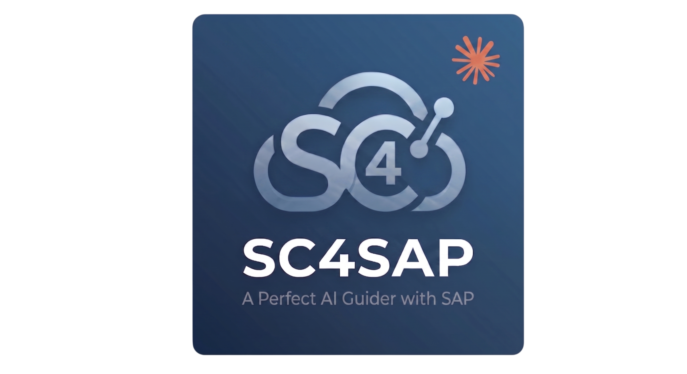

  

  <a href="README.md">English</a> | <a href="README.ko.md">한국어</a> | 日本語 | <a href="README.de.md">Deutsch</a>

# SuperClaude for SAP (sc4sap)

> SAP ABAP 開発向け Claude Code プラグイン — SAP ECC / S/4HANA On-Premise / S/4HANA Cloud (Public & Private) 対応

**公式サイト:** [sc4sap.dev](https://sc4sap.dev)

## sc4sap とは

SuperClaude for SAP は Claude Code をフルスタック SAP 開発アシスタントに変換します。[MCP ABAP ADT サーバー](https://github.com/babamba2/abap-mcp-adt-powerup)(150+ ツール)経由で SAP システムに接続し、クラス・関数モジュール・レポート・CDS ビュー・Dynpro・GUI ステータスなどの ABAP オブジェクトを直接作成・読み取り・更新・削除します。

## 主要機能

| 機能 | 説明 |
|------|------|
| 🔌 **MCP 自動インストール** | `/sc4sap:setup` 中に `abap-mcp-adt-powerup` を自動インストール・設定・接続テスト。手動 MCP 配線不要。 |
| 🌐 **マルチ環境プロファイル (Dev / QA / Prod)** | 会社・ティア別に複数の SAP システム(`KR-DEV`、`KR-QA`、`KR-PRD`、`US-DEV` など)を登録し、`/sc4sap:sap-option` でセッション中に即時切り替え。**QA / Prod プロファイルは自動で読み取り専用保護**:PreToolUse フックと MCP サーバーガードの 2 層防御が `Create*/Update*/Delete*`、`CreateTransport`、コード実行ツールをブロック — フックを回避してもサーバー側で依然として拒否。パスワードは **OS 資格情報ストア** (`@napi-rs/keyring` — Windows Credential Manager / macOS Keychain / libsecret) に保管され、`.sc4sap/` が git にシークレットを漏洩させるリスクなし。成果物(仕様書、CBO カタログ、監査)はプロファイル別に分離され、読み取り専用のクロスビューを提供 — QA セッションが Dev 生成の仕様を汚染せずに参照可能。 |
| 🏗️ **自動プログラムメーカー** | ABAP プログラムのエンドツーエンド生成:Main + 条件付き Include、OOP/Procedural、フル ALV + Docking、Dynpro + GUI ステータス、必須 Text Elements、ABAP Unit — プラットフォーム対応(ECC / S4 On-Prem / Cloud)。 |
| 🔍 **プログラム解析** | MCP で ABAP オブジェクトを読み取り → Clean ABAP / パフォーマンス / セキュリティレビュー、または機能/技術仕様へのリバースエンジニアリング(Markdown/Excel)。 |
| 🧪 **コード解析** | `/sc4sap:analyze-code` — `sap-code-reviewer` 専用の静的レビュー:Clean ABAP / パフォーマンス / セキュリティ / SAP 標準準拠。重大度順の指摘と具体的な修正提案。 |
| 🔀 **プログラム比較** | `/sc4sap:compare-programs` — 同一の業務シナリオを共有しつつモジュール(MM/CO)・国(KR/EU)・ペルソナ(コントローラー/倉庫)で分岐した 2〜5 本の ABAP プログラムをコンサルタント視点で 10 次元比較 → 編集可能な HTML レポート(色分けした判定マトリクス・差分のみ表示、項目差分表、画面の並列比較、判断ガイド、バージョン管理 + 英語版)。 |
| ⚙️ **設定 → ドキュメント** | `/sc4sap:config-to-document` — 接続先システムに実際に設定されているモジュールのカスタマイジングを文書化(MM から)。IMG ツリーに沿ったオフライン HTML ファイル 1 本:IMG アクティビティごとに実テーブル値を SM30 風の画面に描画、顧客トランスポートで変更された行とトランスポート履歴、設定チェック、SAP の IMG ドキュメント、モジュールコンサルタントエージェントが書き `sap-critic` がレビューしたコンサルタントノート。SAP には読み取り専用。ページ内の編集モードでコンサルタントがノート・設定値の表・変更履歴を直し、次のバージョンに引き継げる。 |
| 🖨️ **スマートフォーム プレビュー** | `/sc4sap:smartform-preview` — 印刷プログラムやテストデータなしで SmartForm の出力イメージを JPG で描きます。ウィンドウは実際の mm 位置、SmartStyle のフォント、罫線・網掛け付きのテンプレート、SE78 グラフィック（ロゴ、署名）、サンプル行入りのループ。`&フィールド&` には DDIC の型に合わせた架空のサンプル値が入り、内容が切れるセルとウィンドウをレポートします。読み取り専用。→ `smartforms/<FORM>/<FORM>-preview.{jpg,html}` |
| 📄 **PDF からスマートフォーム** | `/sc4sap:smartform-from-pdf` — 印刷された帳票の PDF（またはスクリーンショット）から SmartForm を作成します。罫線の領域はテンプレートに、すべてのテキストは既存 SmartStyle の最も近い書式で元と同じ位置に置かれます。続いて値を `&フィールド&` に、明細行を内部テーブルのループにし、インターフェースを追加します（ユーザーと一緒に決定）。DEV システムにアップロードして印刷し、元のページと比較してスコアを出します。→ `smartforms/<FORM>/` |
| 📊 **プロジェクトダッシュボード** | `/sc4sap:project-dashboard` — SAP プロジェクトごとに PM と PMO が編集する HTML ページ（サマリー、KPI、Q ゲート付きマイルストーン、ガント付き WBS、チーム、履歴）と、全プロジェクトのポートフォリオページを作成します。新規導入（SAP Activate）、S/4 コンバージョン、ロールアウト、AMS リリース、小規模プロジェクトのテンプレート付き。モジュールコンサルタントと開発コンサルタントを分けて追跡します（WRICEF ステージ、引き継ぎキュー）。実績は接続中のシステムから読み取ります（カスタマイズ／ワークベンチ移送、パッケージオブジェクト、非有効オブジェクト、稼働後のダンプ）。メンバーは日付で参加・離脱し、離脱者の未完了項目を表示します。モバイルでも編集できます。→ `projects/<CODE>/` |
| 🔐 **ロールマトリクス** | `/sc4sap:role-matrix` — プロジェクトの権限設計書を編集可能な HTML ワークブック 1 つで作成します：チェック付き表紙、業務ロール、PFCG ロール、業務ロール × T-code マトリクス（F/C/D）、ユーザー × ロール割当、権限オブジェクト、SoD ルールと自動競合チェック、変更履歴。新規設計はモジュールコンサルタントの提案から（ST03N 利用実績があれば実際に使う T-code に絞り込み）、または SAP から読み取り（ロール、T-code、権限値、組織レベル、ユーザー割当はユーザー ID のみ — ユーザーマスタは読みません）。大きなシステムはページ分割し、検索・CSV・貼り付けはシート全体に適用されます。SAP には書き込みません。→ `roles/<CODE>/` |
| 🧭 **S/4HANA コンバージョン準備分析** | `/sc4sap:s4-conversion-readiness` — ECC から S/4HANA へのコンバージョン前に準備すべきことを 1 つの HTML レポートにまとめます。ターゲット（S/4HANA 2023、2025、パブリッククラウド、比較）を確認し、システムを読み取った後、見つかった根拠とともに検討する拡張（EWM、RAP / Fiori elements、Fiori Launchpad、出力管理、Integration Suite、Event Mesh）を確認します。CBO 参照グラフと保存済みソースを簡素化項目ナレッジベースと照合：変更テーブル（KONV、VBUK/VBUP、MKPF/MSEG、BSEG インデックス・合計テーブル …）、廃止トランザクションと BAPI、ビジネスパートナー、ネイティブ SQL、HANA のソート順、40 桁 MATNR、PI / PO プロキシ、IDoc、ワークフローイベント。影響テーブルの顧客項目は DDIC から読み取り、移行先テーブル（MATDOC、ACDOCA、PRCD_ELEMENTS）、拡張が必要なプロキシ CDS ビュー（MARC、MBEW、BSIS …）、Fiori 用標準 CDS ビューに分けて示します。オブジェクトごとの評価とソース行、概算工数、クリーンコアレベル、チェックリスト付き。SAP には書き込みません。→ `conversion/<CODE>/` |
| 🩺 **運用診断** | 運用トリアージ:ST22 ダンプ、SM02、/IWFND/ERROR_LOG、プロファイラトレース、ログ、where-used — すべて Claude から。 |
| ♻️ **CBO 再利用** | Z パッケージを一度棚卸し → `create-program` / `program-to-spec` が既存 CBO 資産を優先再利用。ブラウンフィールドに必須。 |
| 🧷 **CBO 拡張認識 (CMOD / GGB0·1 / BTE / VOFM / BAdI / APPEND)** | ユーザーエグジット (CMOD)、検証/置換 (GGB0/GGB1)、BTE ファンクションモジュール、VOFM ルーチン (要件 / 計算式 / データ転送)、BAdI 実装、APPEND ストラクチャを棚卸し。`create-program` / BAPI 呼び出しでは既存の拡張フィールド(例:BAPI `EXTENSIONIN` / テーブル append)を新規 CBO より優先;ダンプ・障害対応では拡張ポイントを第一容疑者として検査。 |
| 🏭 **業界コンテキスト** | 14 業界リファレンス (retail, fashion, cosmetics, tire, automotive, pharma, F&B, chemical, electronics, construction, steel, utilities, banking, public-sector)。 |
| 🌏 **国別ローカライゼーション** | 15 カ国 + EU 共通 (KR/JP/CN/US/DE/GB/FR/IT/ES/NL/BR/MX/IN/AU/SG)。適格請求書、銀行、給与、税制。 |
| 🧩 **アクティブモジュール認識** | クロスモジュール統合ヒント:MM + PS 有効 → MM CBO に WBS フィールド自動提案;SD + CO 有効 → CO-PA 派生。[詳細 →](common/active-modules.md) |
| 🤝 **モジュールコンサルテーション** | `sap-analyst` / `sap-critic` / `sap-planner` / `sap-architect` がビジネス判断が必要な場合、14 モジュールコンサルタント + 1 BC コンサルタントに委任。ユーザーが直接質問する場合は `/sc4sap:ask-consultant` — キーワードで SD/MM/FI/CO/PP/PS/PM/QM/TR/HCM/WM/TM/BW/Ariba/BC を自動ルーティングし、プロジェクトに設定された SAP 環境(バージョン・業界・国・アクティブモジュール)に沿って回答、読み取り専用。 |

## ドキュメント

- 📦 **[インストール & セットアップ →](docs/INSTALLATION.ja.md)** — 要件、インストールオプション、ウィザードステップ、ブロックリスト設定
- 🎯 **[機能詳細 →](docs/FEATURES.ja.md)** — 26 エージェント、14 スキル、MCP ツール、RFC バックエンド、フック、データ抽出ポリシー
- 📜 **[変更履歴 →](docs/CHANGELOG.ja.md)** — バージョン履歴と破壊的変更

## Unleashed

  

## 作者

- **paek seunghyun** &nbsp; 

## コントリビューター

- **김시훈 (Kim Sihun)** &nbsp; 

## 謝辞

このプロジェクトは **허예찬 (Hur Ye-chan)** 氏の [**oh-my-claudecode**](https://github.com/huryechan/oh-my-claudecode) から着想を得ています。マルチエージェントオーケストレーションパターン、Socratic ディープインタビューゲーティング、永続ループの概念、プラグイン哲学全般はすべてその作業に遡ります。

**fr0ster** 氏の [**mcp-abap-adt**](https://github.com/fr0ster/mcp-abap-adt) は、私たちがカスタマイズした MCP サーバー(`abap-mcp-adt-powerup`)を構築する上で大きな貢献をしました。先駆的な ADT-over-MCP の取り組み — リクエスト形成、エンドポイントカバレッジ、オブジェクト I/O — は、自社サーバーの設計・拡張時に依拠した概念的基盤となりました。

## ライセンス

[MIT](LICENSE)
