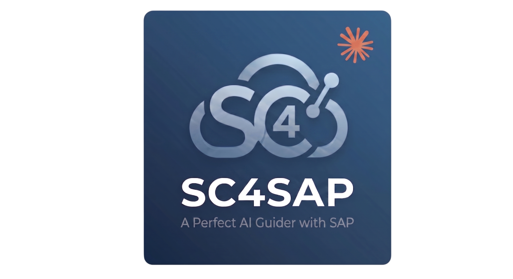

<h2 align="center"><a href="https://sc4sap.dev/install-guide.html">📘 처음이라면 설치 가이드부터 →</a></h2>

<p align="center">Windows 기준 단계별 안내예요. 30~40분이면 끝나요.</p>

<p align="center">
  
</p>

<p align="center">
  <a href="README.md">English</a> | 한국어 | <a href="README.ja.md">日本語</a> | <a href="README.de.md">Deutsch</a>
</p>

# SuperClaude for SAP (sc4sap)

> SAP ABAP 개발을 위한 Claude Code 플러그인 — SAP ECC / S/4HANA On-Premise 지원

<p align="center">
  <a href="https://sc4sap.dev"></a>
</p>

<h1 align="center"><a href="https://sc4sap.dev">🌐 sc4sap.dev</a></h1>

<h3 align="center">SAP 운영, 이제 웹에서 하세요. (베타)</h3>

<p align="center">설치 없이 브라우저에서 sc4sap을 써요. 덤프 분석, 운영 보고서, 프로젝트 대시보드, 권한 설계까지 휴대폰에서도 돼요.</p>

[](https://sc4sap.dev)
[](https://www.npmjs.com/package/@babamba2/abap-mcp-adt-powerup)
[](https://github.com/babamba2/superclaude-for-sap/releases)
[](https://github.com/babamba2/superclaude-for-sap)
[](LICENSE)

## sc4sap이 하는 일

Claude Code를 우리 SAP 시스템에 연결해요. 그러면 ABAP 개발, 문서 작업, 운영 업무를 대신 해 줘요.

- **개발** — 프로그램을 만들고, 리뷰하고, DEV에서 테스트해요.
- **문서** — 설정 문서, 프로세스 맵, 스펙, 매뉴얼을 시스템에서 읽어 만들어요.
- **운영** — 덤프 원인을 찾고, 트랜스포트를 점검하고, 운영 보고서를 써요.

ECC와 S/4HANA On-Premise에서 써요. 현재 버전은 1.0.0이에요.

## 역할별로 할 수 있는 일

### 개발자

| 이렇게 말해요 | 이렇게 받아요 |
|---|---|
| `/sc4sap:create-program` "자재별 재고 ALV 만들어 줘" | Main + Include 구조의 프로그램이에요. 코딩부터 리뷰까지 에이전트가 해요. |
| `/sc4sap:create-object` | 테이블, 클래스, 함수모듈 같은 객체 하나를 만들고 활성화해요. |
| `/sc4sap:program-test` | QA로 옮기기 전에 DEV에서 프로그램을 테스트해요. 기대 결과를 먼저 정하고 케이스별로 판정해요. |
| `/sc4sap:analyze-code` | 코드 리뷰 결과예요. Clean ABAP, 성능, 보안 문제를 근거와 함께 보여 줘요. |
| `/sc4sap:program-to-spec` | 기존 프로그램의 기능·기술 스펙이에요. Markdown, HTML, Excel로 받아요. |
| `/sc4sap:program-to-manual` | 사용자 매뉴얼 HTML이에요. 화면 그림에 번호를 달아 단계별로 설명해요. |
| `/sc4sap:compare-programs` | 비슷한 프로그램 2~5개를 업무 관점으로 비교한 보고서예요. |
| `/sc4sap:interface-mapping-spec` | 인터페이스 매핑 정의서예요. Source → Target 필드와 변환 규칙이 들어가요. |
| `/sc4sap:smartform-preview` | SmartForm 예상 출력물 JPG예요. 잘리는 칸도 알려 줘요. |
| `/sc4sap:smartform-from-pdf` | 출력물 PDF로 SmartForm을 만들어 DEV에 올리고, 원본과 비교해 점수를 매겨요. |
| `/sc4sap:smartform-to-adobe` · `adobe-preview` · `adobe-from-pdf` | Adobe 폼 작업이에요. SmartForm 전환 계획, 출력 미리보기, PDF로 만들기를 해요. `smartform-to-adobe`는 베타라 품질이 아직 낮아요. `adobe-from-pdf`는 아직 승인 대기예요. |

### 현업 컨설턴트

| 이렇게 말해요 | 이렇게 받아요 |
|---|---|
| `/sc4sap:ask-consultant` "이 이동유형은 왜 회계전표가 안 생겨요?" | 모듈 컨설턴트 에이전트의 답이에요. 우리 시스템 버전, 산업, 국가에 맞춰 답해요. |
| `/sc4sap:assist` "미결 PO 보여 줘" | 미결 PO, 입고, 청구 같은 실제 전표를 조회하고 바꿔요. 바꾸기 전에 항상 미리 보여 주고 확인을 받아요. |
| `/sc4sap:config-to-document` | 모듈 설정 문서 HTML이에요. IMG 순서대로 실제 설정값과 변경 이력을 담아요. |
| `/sc4sap:module-to-process` | 모듈 프로세스 맵이에요. 실제로 쓰는 TCode만 보고 L1~L4로 정리해요. |
| `/sc4sap:uat-scenarios` | UAT·통합 테스트 시나리오예요. 회차별 결과를 관리하고 Excel로 내보내요. |
| `/sc4sap:cbo-relation-map` | CBO 객체가 어떻게 이어지는지 그린 관계도예요. 테이블을 바꾸면 어디에 영향이 가는지도 봐요. |
| `/sc4sap:stock-cbo` | CBO 패키지 목록이에요. 새 프로그램을 만들 때 이미 있는 Z 객체를 먼저 쓰게 해요. |

### PM / PMO

| 이렇게 말해요 | 이렇게 받아요 |
|---|---|
| `/sc4sap:project-dashboard` | 프로젝트 대시보드예요. 마일스톤, WBS, WRICEF 진행, SAP 실적을 한 페이지에 담아요. |
| `/sc4sap:role-matrix` | 권한 설계서예요. 역할 × TCode 매트릭스와 SoD 충돌 점검이 들어가요. |

### 운영 (SM / AMS / Basis)

| 이렇게 말해요 | 이렇게 받아요 |
|---|---|
| `/sc4sap:analyze-symptom` "ZMMR00040 덤프 원인 찾아 줘" | 덤프 원인 분석이에요. 단계별로 좁혀 가고 SAP Note 검색어도 알려 줘요. 코드는 바꾸지 않아요. |
| `/sc4sap:ops-health-check` | 운영 보고서예요. 덤프 추이, 중단된 잡, 오류 IDoc을 이전 기간과 비교해요. |
| `/sc4sap:transport-readiness` | 트랜스포트를 QA·PRD로 보내도 되는지 판정해요. 열린 작업, 비활성 객체, 이관 순서를 봐요. |
| `/sc4sap:sap-doctor` | 플러그인, MCP 서버, SAP 연결 상태를 점검해요. |

## 시작하기 (5단계)

1. **준비물** — Claude Code, Node.js 20 이상, ADT를 쓸 수 있는 SAP 사용자가 필요해요. 회사 SAP 서버에 처음 연결하면 Basis 담당자가 웹 포트, ICF, 권한을 먼저 준비해야 해요(가이드 B1~B4).
2. **플러그인 설치** — Claude Code 입력창에 아래 두 줄을 입력해요. 그리고 Claude Code를 다시 시작해요.
   ```
   /plugin marketplace add https://github.com/babamba2/superclaude-for-sap.git
   /plugin install sc4sap
   ```
3. **SAP 연결** — `/sc4sap:setup`을 실행해요. 질문에 하나씩 답하면 돼요. MCP 서버도 이때 설치하고 연결을 테스트해요.
4. **첫 요청** — "구매오더 승인 절차는 어떻게 설정돼 있어요?"처럼 편하게 물어봐요.
5. **결과물 위치** — 문서와 보고서는 프로젝트 폴더의 `.sc4sap/work/<프로필>/` 아래에 저장돼요.

자세한 설치 과정은 [처음 설치 가이드](https://sc4sap.dev/install-guide.html)에 있어요.

## 그냥 말로 하세요

슬래시 명령을 외울 필요가 없어요. 평소처럼 말하면 맞는 스킬로 연결해 줘요.

- "어제부터 뭐가 깨졌는지 봐 줘" → 운영 점검을 바로 해요.
- "이 트랜스포트 오늘 밤 PRD로 보내도 돼?" → 트랜스포트 점검을 바로 해요.
- "구매오더 목록 ALV 프로그램 만들어 줘" → `create-program`을 한 줄로 제안하고, 좋다고 하면 시작해요.

문서를 만들거나 SAP에 쓰는 일은 먼저 제안하고 확인을 받아요.

## 안전 장치

- **QA / PRD 프로필은 읽기 전용이에요.** 훅과 MCP 서버가 두 번 막아요. 훅을 우회해도 서버에서 거부돼요.
- **테이블 데이터는 테이블마다 물어봐요.** 매번 명확하게 승인해야 읽어요.
- **민감한 테이블은 블록리스트로 막아요.**
- **비밀번호는 OS 자격 증명 저장소에 보관해요.** Windows Credential Manager, macOS Keychain 같은 곳이에요.
- **고객 객체(Z / Y)만 다뤄요.** SAP 표준 객체는 건드리지 않아요.
- **모든 변경은 트랜스포트에 담아요.** 활성화하고 문법 검사까지 해요.

## 비용 모드

- `standard` — 품질이 먼저예요. 기본값이에요.
- `eco` — 더 저렴한 모델을 써요. 결과물 종류는 같아요.
- `/sc4sap:sap-option`에서 바꿔요. 한 번만 쓰려면 `/sc4sap:eco <스킬>`로 실행해요.

## 동작 방식

- **MCP 서버** — [abap-mcp-adt-powerup](https://github.com/babamba2/abap-mcp-adt-powerup)으로 SAP에 연결해요. 도구가 150개가 넘어요.
- **전문 에이전트 27개** — 모듈별 컨설턴트, 코드 작성, 리뷰, 점검 담당이 나눠서 일해요.
- **여러 SAP 프로필** — DEV / QA / PRD를 등록하고 바꿔 가며 써요.
- **업무 맥락** — 14개 산업과 15개 국가 + EU 공통 자료를 참고해서 답해요.

## 문서

- 🚀 **[처음 설치 가이드 →](https://sc4sap.dev/install-guide.html)** — Windows 기준으로 Basis 준비부터 설치, SAP 연결까지 단계별로 안내해요. ([Markdown 판](docs/GETTING-STARTED.ko.md))
- 📦 **[설치 및 설정 →](docs/INSTALLATION.ko.md)** — 요구 사항, 설정 마법사 단계, 블록리스트 설정이 있어요.
- 🎯 **[기능 상세 →](docs/FEATURES.ko.md)** — 에이전트, 스킬, MCP 도구, 훅을 자세히 설명해요.
- 📜 **[변경 이력 →](docs/CHANGELOG.ko.md)** — 버전별 변경 사항이에요.

## Unleashed

<p align="center">
  <a href="sc4sap_unleashed.png">
    
  </a>
</p>

## 제작자

- **paek seunghyun** &nbsp; [](https://www.linkedin.com/in/seunghyun-paek-5b83b7183/)

## 기여자

- **김시훈 (Kim Sihun)** &nbsp; [](https://www.linkedin.com/in/sihun-kim-27737132b/)
- **Jan Bloudicek** &nbsp; [](https://github.com/JanBloudicek) — 에이전트 모델 별칭 제안 ([#47](https://github.com/babamba2/superclaude-for-sap/pull/47))

## 감사의 말

이 프로젝트는 **허예찬**님의 [**oh-my-claudecode**](https://github.com/huryechan/oh-my-claudecode)에서 영감을 받았어요. 멀티 에이전트 오케스트레이션, Socratic 딥 인터뷰, 지속 루프, 전체 플러그인 철학이 모두 그 작업에서 왔어요.

**fr0ster**님의 [**mcp-abap-adt**](https://github.com/fr0ster/mcp-abap-adt)는 저희 MCP 서버(`abap-mcp-adt-powerup`)를 만드는 데 큰 도움이 됐어요. 요청 구성, 엔드포인트 범위, 객체 입출력 같은 ADT-over-MCP 선행 작업이 개념의 토대가 됐어요. 저희 서버를 설계하고 넓힐 때 이 토대에 기댔어요.

## 라이선스

[MIT](LICENSE)
