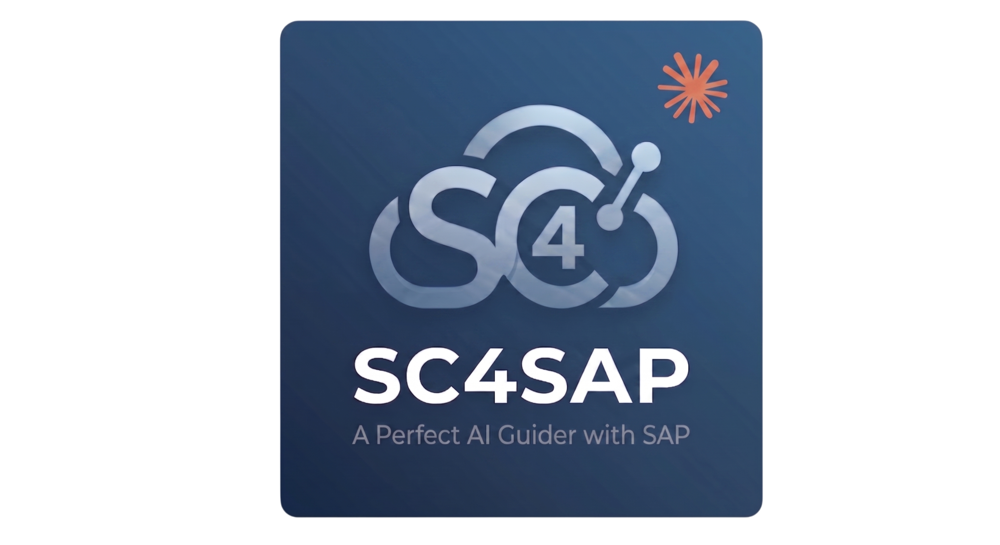

<p align="center">
  
</p>

<p align="center">
  English | <a href="README.ko.md">한국어</a> | <a href="README.ja.md">日本語</a> | <a href="README.de.md">Deutsch</a>
</p>

# SuperClaude for SAP (sc4sap)

> Claude Code, connected to your SAP system. It does ABAP development, documentation and operations work for you.

<p align="center">
  <a href="https://sc4sap.dev"></a>
</p>

<h1 align="center"><a href="https://sc4sap.dev">🌐 sc4sap.dev</a></h1>

<h3 align="center">SAP operations, now on the web.</h3>

<p align="center">No install — use sc4sap in your browser: dump analysis, operations reports, project dashboards and role design, on your phone too.</p>

<p align="center"><a href="https://workspace.sc4sap.dev"><b>Start on the web →</b></a></p>

[](https://sc4sap.dev)
[](https://www.npmjs.com/package/@babamba2/abap-mcp-adt-powerup)
[](https://github.com/babamba2/superclaude-for-sap/releases)
[](https://github.com/babamba2/superclaude-for-sap)
[](LICENSE)

## What is sc4sap?

sc4sap is a plugin for Claude Code. It connects Claude to your SAP system.

- It works with SAP ECC, S/4HANA On-Premise and S/4HANA Cloud (Public and Private).
- It helps developers, functional consultants, project managers and operations teams.
- You ask in plain words. Claude reads the system, does the work and shows you the result.

Current plugin version: 1.0.0.

## What you can do

### Developers

| What you say or type | What you get |
|---|---|
| `/sc4sap:create-program` | A finished ABAP program (report, ALV, batch), tested and activated |
| `/sc4sap:create-object` | One ABAP object (class, table, function module ...) on a transport |
| `/sc4sap:program-test` | A program tested on DEV with real rows and ABAP Unit, before it moves to QA |
| `/sc4sap:analyze-code` | A review of your code with ranked findings and fix suggestions |
| `/sc4sap:program-to-spec` | A functional or technical spec written from existing code |
| `/sc4sap:program-to-manual` | An end-user manual for one program, with screen drawings |
| `/sc4sap:compare-programs` | A side-by-side comparison of 2 to 5 similar programs |
| `/sc4sap:interface-mapping-spec` | An interface mapping spec: source field to target field, with rules |
| `/sc4sap:smartform-preview` | A picture of the expected SmartForm print, without a print program |
| `/sc4sap:smartform-from-pdf` | A SmartForm built from a PDF of the printed form |
| `/sc4sap:smartform-to-adobe`, `adobe-preview`, `adobe-from-pdf` | Adobe form work: conversion plan, print preview, build from PDF. `adobe-from-pdf` is not runnable yet |

### Functional consultants

| What you say or type | What you get |
|---|---|
| `/sc4sap:ask-consultant` | An answer from the consultant for the right module (SD, MM, FI, CO ...) |
| `/sc4sap:assist` | Lookups and changes of business documents: open POs, goods receipt, billing ... Every change is shown first and needs your yes |
| `/sc4sap:config-to-document` | One HTML file with a module's configuration as it is in the system |
| `/sc4sap:module-to-process` | A process map of a module, from the TCodes users really run |
| `/sc4sap:uat-scenarios` | UAT and integration test scenarios, kept as one editable set |
| `/sc4sap:cbo-relation-map` | A map of how your custom objects relate |
| `/sc4sap:stock-cbo` | A list of the custom objects of a package, so new work reuses them |

### PM and PMO

| What you say or type | What you get |
|---|---|
| `/sc4sap:project-dashboard` | One page per project: milestones, WBS, team, SAP actuals. Plus a portfolio page |
| `/sc4sap:role-matrix` | A role and authorization workbook with SoD conflict checks |

### Operations (SM, AMS, Basis)

| What you say or type | What you get |
|---|---|
| `/sc4sap:analyze-symptom` | The root cause of a dump or error, found step by step. Nothing is changed |
| `/sc4sap:ops-health-check` | An operations report: dumps, aborted jobs, update errors, IDocs |
| `/sc4sap:transport-readiness` | A ready / check / blocked verdict for each transport request |
| `/sc4sap:sap-doctor` | A health check of the plugin, the MCP server and the SAP connection |

## Get started

1. Install Claude Code and Node.js 20 or newer. You also need an SAP user with ADT access.
2. In Claude Code, add the marketplace and install the plugin:
   ```
   /plugin marketplace add https://github.com/babamba2/superclaude-for-sap.git
   /plugin install sc4sap
   ```
3. Run `/sc4sap:setup`. It installs the MCP server, saves your SAP connection and tests it.
4. Try one request, for example: `Show me the open purchase orders of vendor 1000.`
5. Files that a skill writes (HTML pages, specs) go to the `.sc4sap/` folder of your project, under your profile.

New to the tools? Follow the step-by-step guide: [Getting Started](docs/GETTING-STARTED.md).

## Just talk to it

You do not need slash commands. Claude picks the right skill from your sentence.

- "Why did program ZMMR00040 dump yesterday?"
- "Write a report that lists open sales orders in ALV."
- "Which TCodes does the MM team use most?"

Questions and lookups run at once. For documents and code, Claude proposes the skill in one line and waits for your yes.

## Safe by design

- QA and PRD profiles are read-only. A hook and the MCP server both block changes.
- Table data is read only after a check against a blocklist. Sensitive tables ask you first, table by table.
- Passwords are kept in your operating system's credential store, not in project files.
- Only customer objects (Z and Y) are changed. SAP standard objects are never touched.
- Every change goes on a transport. It is syntax-checked and activated.
- Business documents are never changed without a preview and your yes.

## Cost modes

- `standard`: quality first. This is the default.
- `eco`: cheaper models for the helper agents. You get the same deliverable.
- Set the mode with `/sc4sap:sap-option`. For one run only, use `/sc4sap:eco <skill>`.

## How it works

- An MCP server for ABAP ADT ([abap-mcp-adt-powerup](https://github.com/babamba2/abap-mcp-adt-powerup), 150+ tools) reads and writes SAP objects.
- 27 specialised agents share the work: module consultants, executor, reviewer, checker and more.
- You can register several SAP profiles (DEV, QA, PRD) and switch between them in a session.
- Industry context (14 industries) and country context (15 countries plus EU) shape the answers.

## Documentation

- [Getting Started](docs/GETTING-STARTED.md): step by step for first-time users
- [Installation and Setup](docs/INSTALLATION.md): requirements, options, blocklist
- [Features](docs/FEATURES.md): all skills, agents, hooks and policies
- [Skill Model Architecture](docs/skill-model-architecture.md): which model does which step
- [Changelog](docs/CHANGELOG.md): version history

## Unleashed

<p align="center">
  <a href="sc4sap_unleashed.png">
    
  </a>
</p>

## Author

- **paek seunghyun** &nbsp; [](https://www.linkedin.com/in/seunghyun-paek-5b83b7183/)

## Contributors

- **김시훈 (Kim Sihun)** &nbsp; [](https://www.linkedin.com/in/sihun-kim-27737132b/)
- **Jan Bloudicek** &nbsp; [](https://github.com/JanBloudicek) — model tier aliases for the agents ([#47](https://github.com/babamba2/superclaude-for-sap/pull/47))

## Acknowledgments

This project was inspired by [**oh-my-claudecode**](https://github.com/huryechan/oh-my-claudecode) by **허예찬 (Hur Ye-chan)**. The multi-agent orchestration patterns, Socratic deep-interview gating, persistent loop concepts, and overall plugin philosophy here all trace back to that work.

[**mcp-abap-adt**](https://github.com/fr0ster/mcp-abap-adt) by **fr0ster** was a major contribution to building our customized MCP server (`abap-mcp-adt-powerup`). The pioneering ADT-over-MCP work — request shaping, endpoint coverage, object I/O — provided the conceptual foundation we drew on while designing and extending our own server.

## License

[MIT](LICENSE)
