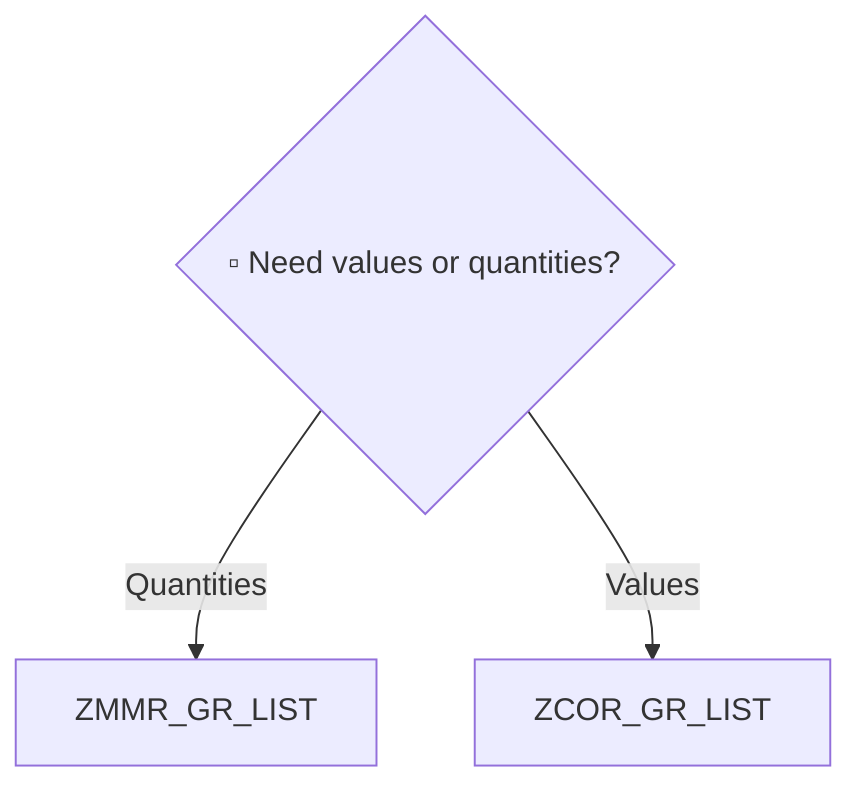

# Report Markdown Template

`sap-writer` fills this skeleton in Step 5 ([`render-steps.md`](render-steps.md)). The `.md` is the **source** of the HTML page: `scripts/spec/md-to-html.mjs --editable` builds it, and the reader's page edits are imported back into a new `.md` version. All headings and prose are in the report language (SKILL.md `Language_Policy`); the example below is English — translate the headings and narrative, keep the structure.

**Before writing, read [`../program-to-spec/html-markup.md`](../program-to-spec/html-markup.md)** — numbered headings, the fact list, SAP names first in key cells, `> [!KIND]` callouts, `<span class="tech">` and `<!-- audience: technical -->`. The comparison-specific markup is below.

## Comparison markup — what the page draws from it

| Write | The page shows |
|---|---|
| A table cell that **starts with** `✅` / `🔷` / `⚠️` / `❓` (e.g. `⚠️ Divergent`) | Coloured verdict cell (same / variant / divergent / unclear); the row is a "difference" unless every verdict cell is ✅ |
| A cell holding **only** `●` (present) or `○` (absent) | Coloured presence dot; a row with any `○` is a difference |
| Either of the above in a table | Sticky first column + the toolbar's **Differences only** switch (hides the "same" rows) |
| `<span class="ev">…</span>` at the end of a per-program matrix cell | An ⓘ on the cell; hovering shows the evidence (the FACT it rests on: statement + FORM / line). Hidden in the Functional view, small brackets in print |
| `<!-- layout: side-by-side -->` on its own line, then one image paragraph per program | The images share one row (stacked on narrow screens / in print) |
| ```` ```mermaid ```` `flowchart TD` | The decision tree, drawn online (source text offline) |

Nothing else is styled specially — no HTML layout, no inline styles.

## Template body (English example — replace ▫)

````markdown
# Program Comparison: ZMMR_GR_LIST vs ZCOR_GR_LIST

- **Programs**: ZMMR_GR_LIST · ZCOR_GR_LIST
- **Scenario**: ▫ Goods receipt lookup
- **Modules**: ▫ MM · CO
- **Dimensions**: ▫ 7 (1·2·3·5·6·7·10)
- **Result**: ▫ Divergent 4 · Variant 2 · Same 1 · Unclear 0
- **System**: ▫ S/4HANA 2023 · client 100 · **Generated**: ▫ 2026-10-14

## 1. Executive Summary

▫ Three sentences: the shared scenario · the biggest ⚠️ divergence · the recommendation.

> [!IMPORTANT]
> ▫ The one decision a consultant must not get wrong (e.g. "Month-end values come only from ZCOR_GR_LIST").

## 2. Which program when — decision guide

| Situation | Use | Why |
|---|---|---|
| ▫ Daily GR quantity check | **ZMMR_GR_LIST** | ▫ Quantity- and material-centric |
| ▫ Month-end cost review | **ZCOR_GR_LIST** | ▫ Values and cost elements |



## 3. Shared baseline

- ▫ Business scenario · shared selection fields · shared output purpose

## 4. Comparison matrix

Legend: ✅ Same · 🔷 Variant · ⚠️ Divergent · ❓ Unclear

| # | Dimension | ZMMR_GR_LIST | ZCOR_GR_LIST | Verdict |
|---|---|---|---|---|
| 1 | Module / Domain | MM (inventory movement) <span class="ev">package ZMMPAEK · SELECT MSEG (FORM get_data, L40)</span> | CO (cost accounting) <span class="ev">SELECT ACDOCA (FORM read_acdoca, L88)</span> | ⚠️ Divergent |
| 2 | Org / Country scope | All company codes | All company codes | ✅ Same |

### 4.1 Selection fields

| Field | Meaning | ZMMR_GR_LIST | ZCOR_GR_LIST |
|---|---|---|---|
| **S_WERKS** | Plant | ● | ● |
| **S_MATNR** | Material | ● | ○ |
| **S_KOSTL** | Cost center | ○ | ● |

### 4.2 Output columns

(Same shape: one row per column field, ● / ○ per program.)

## 5. Screens side by side

### 5.1 Selection screens

<!-- layout: side-by-side -->


### 5.2 Output lists

(Same pattern with `alv.png`.)

## 6. Per-program detail

### 6.1 ZMMR_GR_LIST

- **Package**: ▫ · **Persona**: ▫ Warehouse clerk (daily)
- **Core data**: ▫ MSEG, MKPF
- **Business logic**: ▫ Sum of quantities; no unit conversion
- **Authorizations**: ▫ M_MSEG_WWA
- **Consultant view**: ▫ (from the module consultant, when Step 4b ran)

## 7. Consolidation opportunities

- ▫ (optional section — drop it when there is nothing to say)

## 8. Risks & open questions

> [!WARNING]
> ▫ Risks a reader must see (hard-coded org values, missing authority checks, …).

- ▫ Items to confirm with the business; data-sample questions that the extraction policy keeps out of scope.

## 9. Appendix
<!-- audience: technical -->

### 9.1 Authorization objects (verbatim)

| Object | Program | Fields | Value |
|---|---|---|---|
| **M_MSEG_WWA** | ZMMR_GR_LIST | WERKS, ACTVT | 03 |

### 9.2 Tables / CDS

| Table / CDS | Program | Note |
|---|---|---|
| **MSEG** | ZMMR_GR_LIST | Material document item |
````

## Rendering rules

1. **Omit unused parts** — a dimension not selected in Step 2 loses its matrix row and its own section (§4.1 needs dimension 3, §4.2 needs 6, §9.1 needs 7, §9.2 needs 4, a CBO table needs 8). §5 only when Step 5 drew at least one screen; a program without a picture gets a one-line note in that row's place, not an empty image.
2. **Always present**: fact list, §1, §2, §4 matrix, §6, and §8 when anything is ❓.
3. **Every ▫ replaced.** Genuinely unknown → `❓ Not determined — confirmation needed`, and the item goes to §8.
4. **Verdict cells** start with the mark and its word (`⚠️ Divergent`), so the page colours them and the text stays readable without colour. Presence cells hold only `●` / `○` — put remarks in a separate column.
5. **Evidence** — every per-program matrix cell whose verdict is not ✅ ends with `<span class="ev">…</span>`: the FACT it rests on, ≤ 120 characters (statement + FORM / line). A ❓ cell's evidence says what was missing.
6. **Key columns** — in §4.1 / §4.2 / §9 the first column holds the SAP name in bold; spell it identically everywhere so the page links it.
7. **The `Result` fact** counts the matrix verdicts, in the order Divergent · Variant · Same · Unclear.
8. **No code snippets.** Paraphrase load-bearing logic in business terms; FORM / line anchors go in `<span class="tech">…</span>`.
9. **Length** — 3–8 printed pages. Trim narrative before dropping sections.
10. **Language** — translate headings, table headers, the fact-list and per-program labels (`Programs`, `Persona`, `Core data` …), the legend and verdict words; keep program, table, field and authorization object names, T-Codes and the `●` / `○` / verdict marks as they are.
